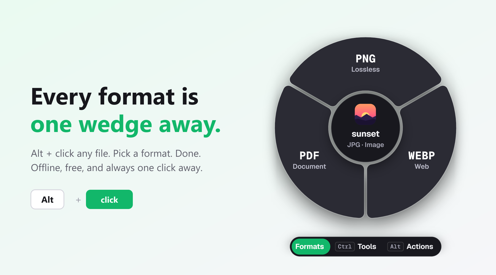
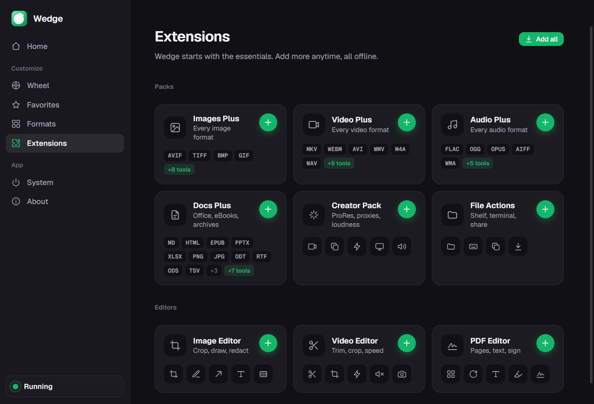

<p align="center">
  
</p>

<h1 align="center">Wedge</h1>

<p align="center">
  <b>Convert any file with Alt + click.</b><br>
  Free · Works offline · No account
</p>

<p align="center">
  <a href="https://github.com/MohitGupta12/wedge/releases/latest"><b>⬇ Download</b></a>
</p>

<p align="center">
  
</p>

## How it works

1. **Hold Alt and click a file** in File Explorer or on your desktop.
2. **Pick a format** from the wheel that pops up.
3. **Done.** The new file appears right next to the old one.

Your original file is never changed, and nothing is uploaded anywhere.

## Install

### 🪟 Windows

1. Download **`Wedge.Setup.0.1.0.exe`** from the [Download page](https://github.com/MohitGupta12/wedge/releases/latest).
2. Open it and click through the installer.
   - If you see **"Windows protected your PC"**, click **More info**, then **Run anyway**. [Why?](#why-does-windows-or-mac-show-a-warning)
3. When Wedge asks **"Start with Windows?"**, click **Yes**.

That's it. Wedge now waits quietly in the background. Try **Alt + click** on any photo.

### 🍎 Mac (beta, M1 or newer)

1. Download **`Wedge-0.1.0-macOS-AppleSilicon-beta.dmg`** and drag Wedge into **Applications**.
2. Open Wedge. If macOS blocks it, go to **System Settings → Privacy & Security** and click **Open Anyway**.
3. Allow **Accessibility** when Wedge asks.
4. Use **Option (⌥) + click** on a file in Finder.

<details>
<summary>macOS says Wedge "is damaged"?</summary>

Open **Terminal**, paste this, press Enter, then open Wedge again:

```bash
xattr -dr com.apple.quarantine /Applications/Wedge.app
```
</details>

### 🐧 Linux (beta)

1. Download **`Wedge-0.1.0-linux-x86_64-beta.AppImage`**.
2. Right-click it → **Properties → Permissions → Allow executing as program**, then double-click it.
3. **Alt + drag** a file onto the wheel.

<details>
<summary>More Linux options</summary>

- Prefer a package? Install the `.deb` instead: `sudo apt install ./wedge_0.1.0_amd64-beta.deb`
- Install `xdotool` and `xprop` so Wedge knows when you're in a file manager: `sudo apt install xdotool x11-utils`
- If Alt + drag moves windows on your desktop, choose another shortcut in Wedge's **Wheel** settings.
</details>

> The Mac and Linux versions are new and haven't been tested on real computers yet. If something doesn't work, please [tell us](https://github.com/MohitGupta12/wedge/issues).

## What can it convert?

| File | Becomes |
| --- | --- |
| 🖼️ Photos (including iPhone HEIC) | JPG, PNG, WebP, PDF |
| 🎬 Videos | MP4, MOV, GIF, MP3 |
| 🎵 Music and audio | MP3, WAV, M4A |
| 📄 PDFs | Word, JPG, PNG, text |
| 📝 Word, Excel, PowerPoint | PDF and more |
| 📦 ZIP and RAR | Extract, or zip up |

Want more formats, or a simple image, video or PDF editor? Open Wedge and go to **Extensions**. Everything there is free.

<p align="center"></p>

## Questions

### Do I need to open Wedge every time?

No. Wedge runs in the background (look for the green icon near the clock). Just Alt + click a file.

### Why does Windows or Mac show a warning?

Windows and macOS warn about apps whose developer hasn't paid for a code-signing certificate yet. Wedge is safe, and all of its code is public here. We're working on signing it so the warning goes away.

### Does it slow down my computer?

No. When you're not converting, Wedge uses no CPU and only a little memory, about as much as one browser tab.

### Where does the new file go?

Right next to the original, with the new extension (`photo.jpg` → `photo.png`). It never overwrites anything.

### How do I pause or uninstall it?

- **Pause:** right-click the Wedge icon near the clock → **Pause**.
- **Uninstall:** Windows **Settings → Apps → Wedge → Uninstall**.

## License

Wedge is **free and open source**. You can use it for anything, for free. If you change the code and share your version, you have to share your code too. That's the [AGPL-3.0 license](LICENSE), required by the PDF and video tools Wedge uses.

## Code signing policy

Free code signing provided by [SignPath.io](https://about.signpath.io/), certificate by [SignPath Foundation](https://signpath.org/). *(Application pending: Windows releases will be signed once it's approved.)*

- **Committers and reviewers:** [MohitGupta12](https://github.com/MohitGupta12)
- **Approvers:** [MohitGupta12](https://github.com/MohitGupta12)

Only builds made by GitHub Actions from this repository's source code are signed, and every signing request is approved by hand.

**Privacy:** This program will not transfer any information to other networked systems unless specifically requested by the user or the person installing or operating it. All conversions run on your computer.

---

<sub>Want to build Wedge yourself or help out? See the [developer guide](DEVELOPMENT.md). Wedge is an independent project inspired by Tangerine for Mac and isn't affiliated with it.</sub>
