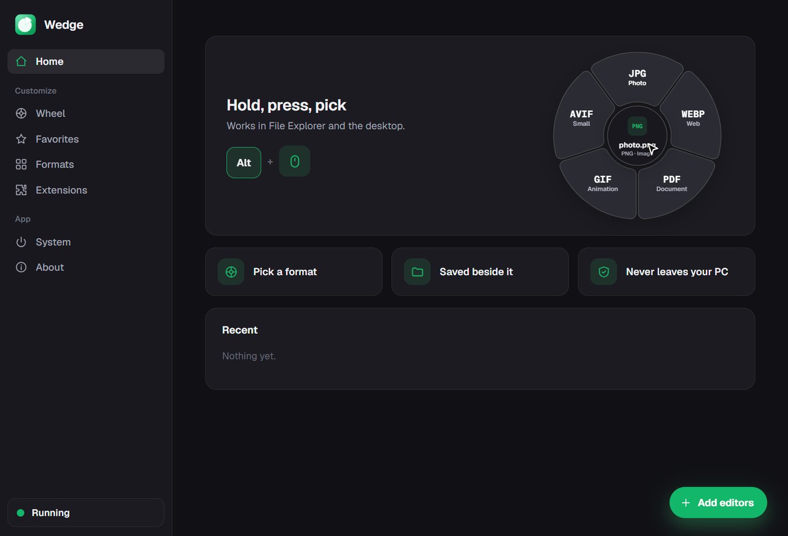
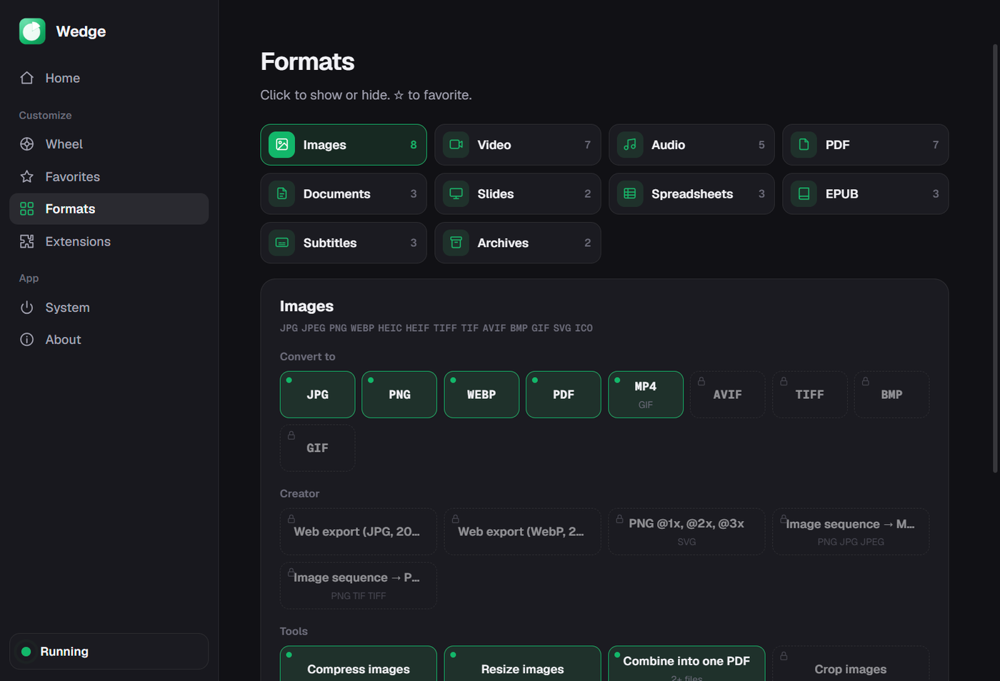

<p align="center">
  
</p>

<h1 align="center">Wedge</h1>

<p align="center">
  <b>Alt + click any file. Pick a format. Done.</b><br>
  A free, offline file converter that lives one click away from every file on your PC.
</p>

<p align="center">
  <a href="https://github.com/MohitGupta12/wedge/releases/latest"><b>⬇ Download for Windows</b></a>
  &nbsp;·&nbsp; <a href="#mac-and-linux-beta">Mac &amp; Linux (beta)</a>
  &nbsp;·&nbsp; <a href="#install-on-windows">Install</a>
  &nbsp;·&nbsp; <a href="#what-it-can-do">What it can do</a>
  &nbsp;·&nbsp; <a href="#faq">FAQ</a>
</p>

<p align="center">
  
</p>

---

## Why Wedge?

You have a HEIC from your phone and need a JPG. A video that's too big to send. A Word file someone wants as a PDF. Usually that means a sketchy upload site or an app you open once a year.

With Wedge you **hold Alt and click the file**, right where it is, in File Explorer or on your desktop. A wheel of formats opens around it. Pick one and the new file appears **next to the original**. That's it.

- ⚡ **Instant.** No app to open, no upload, no waiting in a queue.
- 🔒 **Private.** Everything runs on your computer. Your files never leave it.
- 🪶 **Light.** It waits quietly in the tray and uses no CPU while you're not converting.
- 🎯 **Out of your way.** There's no window you need to keep open. Close Settings and it keeps working.
- 💸 **Free.** No account, no watermark, no limits.

## Install on Windows

1. **Download** `Wedge Setup x.y.z.exe` from the [latest release](https://github.com/MohitGupta12/wedge/releases/latest).
2. **Run it.** Windows may show *"Windows protected your PC"* because Wedge isn't code-signed yet. Click **More info → Run anyway**.
3. **Pick a folder** (the default is fine) and finish the installer.
4. Wedge opens once and asks whether to **start with Windows**. Say yes: it then waits in the tray, so Alt + click always works.
5. Windows asks for **admin approval (UAC)** once. That adds **Convert with Wedge** to your right-click menu. You can say no; everything else still works.

That's the whole setup. You can close the Wedge window now.

> **Tip:** Windows 11 tucks new tray icons away. Click the **^** next to the clock and drag the Wedge icon onto the taskbar if you want to see it.

## Mac and Linux (beta)

> ⚠️ **Untested beta.** These builds pass the automated tests on GitHub, but nobody has used them on a real Mac or Linux PC yet. Expect rough edges, and please [report what you find](https://github.com/MohitGupta12/wedge/issues).

### macOS (Apple Silicon: M1 or newer)

1. Download `Wedge-0.1.0-macOS-AppleSilicon-beta.dmg` from the [release page](https://github.com/MohitGupta12/wedge/releases/latest), open it and drag **Wedge** into **Applications**.
2. Open Wedge. Because it isn't notarized by Apple yet, macOS blocks it the first time. Go to **System Settings → Privacy & Security** and click **Open Anyway**.
   If macOS says the app *"is damaged"*, run this once in Terminal, then open it again:
   ```bash
   xattr -dr com.apple.quarantine /Applications/Wedge.app
   ```
3. When Wedge asks, allow **Accessibility** access (System Settings → Privacy & Security → Accessibility). It needs that to notice the shortcut.
4. Hold **Option (⌥)** and click a file in Finder or on the desktop. The first time, macOS asks whether Wedge may control Finder: allow it, so Wedge can see which file you clicked.

Intel Macs aren't supported by this build yet.

### Linux (64-bit, X11)

1. Download one of these from the [release page](https://github.com/MohitGupta12/wedge/releases/latest):
   - `Wedge-0.1.0-linux-x86_64-beta.AppImage`: make it executable and run it.
     ```bash
     chmod +x Wedge-0.1.0-linux-x86_64-beta.AppImage
     ./Wedge-0.1.0-linux-x86_64-beta.AppImage
     ```
   - `wedge_0.1.0_amd64-beta.deb` for Ubuntu, Debian and friends:
     ```bash
     sudo apt install ./wedge_0.1.0_amd64-beta.deb
     ```
2. Install `xdotool` and `xprop` so Wedge can tell when you're in a file manager (on Ubuntu: `sudo apt install xdotool x11-utils`).
3. **Alt + drag** a file onto a wedge. Linux file managers don't tell other apps which file was clicked, so on Linux you drag instead of click.

Good to know: many Linux desktops use Alt + drag to move windows. If yours does, pick another shortcut under **Wheel**. On Wayland, Wedge only sees apps that run through XWayland.

## Use it

| Do this | And Wedge |
| --- | --- |
| **Alt + click** a file in File Explorer or on your desktop | Opens the wheel around it. Click a format to convert. |
| **Alt + drag** a file onto a wedge | Converts as soon as you let go. |
| **Right-click** a file → **Convert with Wedge** | Opens the same wheel. |
| Press **Esc** or click anywhere else | Closes the wheel. |

The converted file is saved **next to the original** (`photo.jpg` → `photo.png`). The original is never changed, and nothing is ever overwritten: you get `photo (1).png` instead.

## What it can do

<p align="center"></p>

### Out of the box

| Your file | One click turns it into |
| --- | --- |
| 🖼️ Image (JPG, PNG, WebP, **HEIC**, AVIF, TIFF, GIF, SVG…) | JPG · PNG · WebP · PDF |
| 🎬 Video (MP4, MOV, MKV, WebM, AVI…) | MP4 · MOV · GIF · MP3 (audio only) |
| 🎵 Audio (MP3, WAV, FLAC, M4A, OGG…) | MP3 · WAV · M4A |
| 📄 PDF | Word (DOCX) · JPG · PNG · text |
| 📝 Documents (DOCX, Markdown, HTML, EPUB…) | PDF · DOCX · TXT |
| 📊 Spreadsheets (XLSX, CSV, ODS, Numbers) | XLSX · CSV · PDF |
| 🖥️ Slides (PPTX) | PDF · PNG |
| 📦 Archives (ZIP, RAR, TAR, GZ) | Extract · ZIP |
| 💬 Subtitles (SRT, VTT) | SRT · VTT · TXT |

Plus handy **tools** on a second wheel: compress images, videos and PDFs, resize, mute a video, grab a frame, merge or split PDFs, zip files. Turn it on in **Wheel → Tools and actions**, then tap **Ctrl** while the wheel is open.

### Add more with free extensions

Wedge starts small so the wheel stays simple. Add what you need under **Extensions**, all offline and one click each:

<p align="center"></p>

| Extension | Adds |
| --- | --- |
| **Images Plus · Video Plus · Audio Plus** | Every other format and tool for that kind of file (AVIF, TIFF, BMP, MKV, WebM, FLAC, OPUS and more) |
| **Docs Plus** | More PDF, Office, eBook, subtitle and archive conversions (Markdown, HTML, EPUB, PPTX, XLSX…) |
| **Creator Pack** | A Creator wheel for video people: ProRes, DNxHR, editing proxies, fixing phone frame rates, 9:16 Reels, loudness for Spotify, YouTube and podcasts |
| **File Actions** | Copy to or move into a folder, open in terminal, a floating shelf, share |
| **Image Editor** | Crop, draw, arrows, text, highlight, blur out private info |
| **Video Editor** | Trim on a timeline, crop to 9:16 or 1:1, change speed, mute, save a frame |
| **PDF Editor** | Reorder, rotate and delete pages, add text, highlight, **sign** |

### Make it yours

<p align="center"></p>

- **Formats:** choose exactly which formats show up on the wheel, per file type.
- **Favorites:** star the conversions you use most and they lead the wheel.
- **Shortcut:** don't like Alt? Record any other combination under **Wheel**.
- **Look:** small, medium or large wheel, light or dark, eight accent colors.
- **Saving:** next to the original, or always into one folder.

## FAQ

### Do I have to open Wedge to use it?

No. Once it's installed it runs in the background (look for the green icon in the tray). Closing the Wedge window doesn't stop it. Turn on **System → Start with Windows** and it's ready every time you log in.

### Is it really offline?

Yes. Every conversion runs on your PC with bundled engines (libvips, FFmpeg, MuPDF and friends). There's no account and nothing is uploaded.

### Will it slow my computer down?

No. While idle it uses no CPU and roughly 200 MB of memory. The heavy converters only load while a conversion runs.

### Why Alt and not another key?

In File Explorer, Shift + click and Ctrl + click change which files are selected. Alt + click doesn't, so the wheel never messes up your selection. You can still pick another shortcut under **Wheel**.

### Windows says the app is unrecognized. Is it safe?

Wedge isn't signed with a paid certificate yet, so Windows doesn't recognize it. Click **More info → Run anyway**. All the source code is in this repo if you'd like to check it.

### Why does the right-click menu need admin approval?

Windows 11 only puts apps into its main right-click menu if they register a small app package, and unsigned packages have to be installed for all users. If you decline, you'll still find Wedge under **Show more options**.

### How do I pause it or quit?

Click **Running** at the bottom of the Wedge sidebar to pause (it turns red). Or right-click the tray icon and choose **Pause** or **Quit Wedge**.

### How do I uninstall it?

Open Windows **Settings → Apps → Installed apps → Wedge → Uninstall**. That removes the right-click menu too.

### Does it work on Mac or Linux?

There are **beta** downloads for both on the [release page](https://github.com/MohitGupta12/wedge/releases/latest). They pass the automated tests but haven't been tried on real computers yet, so expect rough edges. See [Mac and Linux (beta)](#mac-and-linux-beta), and please [open an issue](https://github.com/MohitGupta12/wedge/issues) if something breaks.

---

## For developers

### Build from source

```bash
npm install
npm start          # run it
npm test           # end-to-end self-test: converts generated fixtures through every engine
npm run dist:win   # Windows installer (dist:mac / dist:linux on those systems)
```

Each platform has to be built on that OS. Pushing a `v*` tag (or running the **Build installers**
workflow from the Actions tab) builds and self-tests Wedge on Windows, macOS and Linux runners.

The native Windows pieces (the right-click handler `build/shell/WedgeShell.dll` and the shell helper
`src/main/native/wedge-helper.exe`) are checked in. To rebuild them, install
[llvm-mingw](https://github.com/mstorsjo/llvm-mingw) and run `npm run build:shell`.

**LibreOffice is optional.** If it's installed, Wedge uses it for high-fidelity Word, Excel and
PowerPoint → PDF and to open DOC, ODT, RTF, PPT, ODP and Keynote files.

### Platform notes

- **Windows:** a small native helper (`src/main/native/wedge-helper.exe`, source in `src/shell`) tells Wedge
  whether the cursor is over Explorer or the desktop and which file was clicked.
- **macOS:** needs **Accessibility** permission for the global key/mouse hook; Settings shows a button for it.
- **Linux:** works on X11 with `xdotool` and `xprop` installed. On Wayland the hook only sees XWayland apps.
- Set `WEDGE_DEBUG=1` to log the gesture flow to the terminal.

### Project layout

```
src/main/main.js          tray, wheel, settings window, IPC
src/main/gesture.js       system-wide "hold the shortcut + click" detection (uiohook-napi)
src/main/context.js       is the cursor over a file manager, and which file was clicked
src/main/shellmenu.js     the Windows 11 right-click menu (sparse package + WedgeShell.dll)
src/main/catalog.js       every conversion, tool, action and extension
src/main/engines/         image, media, pdf, docs, sheets, archive, subtitles, office, editors
src/renderer/             wheel, settings window, editors, shelf
src/shell/                C++ sources for the Windows helper and right-click handler
scripts/self-test.js      end-to-end engine test (runs inside Electron)
```

To add a conversion, add one entry in `src/main/catalog.js`; the wheel picks it up automatically.

### License

Wedge is released under the [GNU AGPL-3.0](LICENSE), because it bundles MuPDF (AGPL-3.0) and a GPL
build of FFmpeg. To ship it under a different license, swap MuPDF for a commercially licensed build
(or pdf.js) and use an LGPL FFmpeg build.

Wedge is an independent project inspired by Tangerine for Mac and is not affiliated with it.
